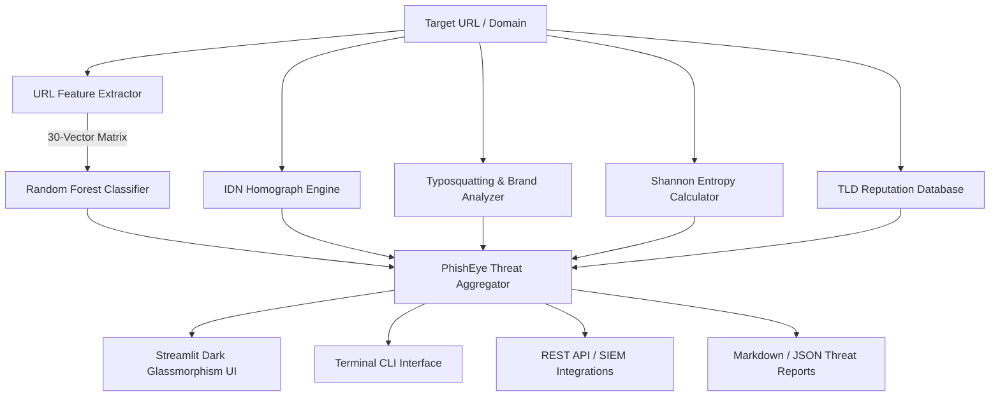

# 🛡️ PhishEye - Real-Time Phishing Threat Intelligence Engine

[](https://python.org)
[](https://streamlit.io)
[](https://scikit-learn.org)
[](https://www.docker.com/)
[](LICENSE)

**PhishEye** is an enterprise-grade cybersecurity intelligence platform and real-time phishing detection engine. Combining Machine Learning Random Forest classification across **30 structural URL vectors** with heuristic forensic engines (IDN Homographs, Levenshtein Typosquatting, Shannon Entropy, and TLD Abuse Intelligence), PhishEye empowers SOC analysts, incident response teams, and automated pipelines to identify and neutralize malicious domains before harm occurs.

---

## 🌟 Key Capabilities

- **⚡ 30-Dimension ML Feature Extraction:** Extracts syntactic, structural, and protocol indicators including IP hosting, SSL states, subdomains, prefix-suffix hyphens, and redirect patterns.
- **🎯 Brand Impersonation & Typosquatting:** Detects combosquatting and Levenshtein edit-distance spoofing against top global financial, cloud, and tech brands.
- **🌐 IDN Homograph & Punycode Engine:** Discovers deceptive foreign Unicode glyphs (Cyrillic, Greek lookalikes) and decoded `xn--` Punycode spoofing attempts.
- **🎲 Shannon Entropy & DGA Detection:** Identifies algorithmic character randomness typical of Domain Generation Algorithms (DGA) and disposable phishing hosts.
- **🛡️ SOC Defanging & Refanging Toolkit:** Automatically defangs dangerous URLs (`hxxps[://]evil[.]com`) for safe documentation without click risk.
- **📂 Bulk Batch Scanning:** High-throughput batch inspector for text lists and CSV files with CSV export.
- **🖥️ Multi-Channel Access:** Interactive Streamlit Glassmorphism Dashboard, command-line interface (CLI), and REST API.
- **📄 Multi-Format Threat Reporting:** Generates forensic reports in Markdown, JSON, and CSV.

---

## 🏗️ System Architecture



---

## 📊 Model Performance & Benchmarks

Evaluated on the UCI Phishing Dataset with 5-Fold Stratified Cross-Validation:

| Metric | Score |
| :--- | :---: |
| **Cross-Validation Accuracy** | **96.98% ± 0.25%** |
| **ROC-AUC Score** | **99.56% ± 0.11%** |
| **Precision** | **98.37%** |
| **Recall** | **99.11%** |
| **F1 Score** | **98.74%** |

---

## 🚀 Quick Start

### 1. Installation

```bash
# Clone the repository
git clone https://github.com/harshh-0304/PhishEye.git
cd PhishEye

# Install dependencies
pip install -r PhishEye/requirements.txt
pip install -e .
```

### 2. Launch the Streamlit Web Application

```bash
streamlit run PhishEye/App.py
```
Open your browser at `http://localhost:8501`.

---

## 💻 Command-Line Interface (CLI)

PhishEye includes a terminal CLI with ANSI color formatting:

```bash
# Scan a single URL
python PhishEye/cli.py -u "https://google.com"

# Scan with defanged output and JSON formatting
python PhishEye/cli.py -u "http://paypal-security-account.login-auth.com/verify@user" --defang --json

# Run high-throughput batch scan from a file and save CSV report
python PhishEye/cli.py -f urls.txt -o scan_results.csv
```

### Sample CLI Output

```text
    ╔═══════════════════════════════════════════════╗
    ║        🛡️  PHISHEYE SECURITY CLI v2.1.0        ║
    ║   Real-Time ML-Powered Threat Intelligence    ║
    ╚═══════════════════════════════════════════════╝

Target URL: http://paypal-security-account.login-auth.com/verify@user
Verdict:    🚨 PHISHING DETECTED (Risk: 84.75%)

Risk Indicators Triggered:
  • No HTTPS Protocol - Connection lacks SSL/TLS encryption.
  • '@' Character Injection - Used to obscure true destination authority.
  • Hyphenated Domain - Hyphen in hostname indicates brand spoofing attempt.

⚠️ Brand Impersonation Alert: Combosquatting detected: brand 'paypal' used within domain label 'paypal-security-account' on unauthorized host.
───────────────────────────────────────────────
```

---

## 🔌 REST API Endpoints

PhishEye provides a lightweight REST API for SOAR pipelines and SIEM ingestion:

```bash
# Start the API server on port 8000
python -c "from phisheye.api import run_api_server; run_api_server('0.0.0.0', 8000)"
```

### API Routes

| Method | Endpoint | Description |
| :--- | :--- | :--- |
| `GET` | `/api/v1/health` | Healthcheck and model readiness status |
| `GET` | `/api/v1/features` | List all 30 feature schema names |
| `POST` | `/api/v1/scan` | Analyze a single URL (`{"url": "https://..."}`) |
| `POST` | `/api/v1/batch-scan` | Batch analyze URLs (`{"urls": ["url1", "url2"]}`) |

---

## 🐳 Docker Deployment

Run the complete PhishEye environment in Docker with zero setup:

```bash
# Build and run with docker-compose
docker-compose up --build
```

- Web Dashboard: `http://localhost:8501`
- REST API: `http://localhost:8000/api/v1/health`

---

## 🧪 Automated Testing

PhishEye includes 40+ unit and integration tests:

```bash
# Run complete test suite
PYTHONPATH=PhishEye python -m unittest discover -s PhishEye/tests -v
```

---

## 📁 Repository Structure

```text
├── .github/workflows/          # CI and Security Audit workflows
├── PhishEye/
│   ├── .streamlit/             # Streamlit visual configurations
│   ├── phisheye/               # Core PhishEye Python engine
│   │   ├── __init__.py         # Package entry and version metadata
│   │   ├── api.py              # REST API server implementation
│   │   ├── cli.py              # Command-line interface logic
│   │   ├── detector.py         # Model inference and probability scoring
│   │   ├── entropy.py          # Shannon entropy & DGA detection
│   │   ├── extractor.py        # 30-Dimension URL feature extractor
│   │   ├── homograph.py        # IDN homograph & Punycode detector
│   │   ├── reporter.py         # Multi-format report exporter
│   │   ├── security.py         # URL defanging & sanitization
│   │   ├── tld_intel.py        # TLD abuse reputation registry
│   │   └── typosquat.py        # Brand impersonation analyzer
│   ├── tests/                  # Unit and integration test suite
│   ├── App.py                  # Streamlit Cyber Guard Web Dashboard
│   ├── cli.py                  # CLI executable entrypoint
│   ├── evaluate_model.py       # Cross-validation benchmark suite
│   ├── model_trainer.py        # Model training pipeline
│   ├── requirements.txt        # Python dependency manifest
│   └── style.css               # Dark Tech glassmorphism stylesheet
├── Dockerfile                  # Container build instructions
├── docker-compose.yml          # Container orchestration
├── pyproject.toml              # Modern Python packaging configuration
├── setup.py                    # Setuptools build script
├── CONTRIBUTING.md             # Developer contribution guidelines
├── SECURITY.md                 # Vulnerability disclosure policy
├── LICENSE                     # MIT License
└── README.md                   # Project documentation
```

---

## 📄 License & Attribution

This project is licensed under the **MIT License** - see the [LICENSE](LICENSE) file for details.

Developed with ❤️ by [harshh-0304](https://github.com/harshh-0304).
